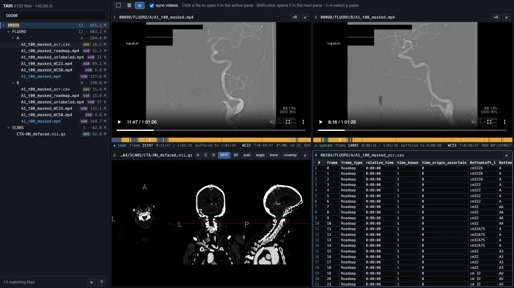

# `tair-viewer`

[](LICENSE)
[](https://tair.kitware.com/clinical-data/)

A zero-install viewer for flipping through the [TAIR](https://tair.kitware.com/clinical-data/) cerebrovascular imaging dataset **without downloading 100+ GB.**



*Biplane DSA (A and B) synced on the procedure clock, a head-and-neck CTA, and an OCR table, side by side.*

## Highlights

- ⚡️ Instant file tree: the whole bucket is listed once in about 1 s and cached; navigation, expanding folders and filtering all happen in memory
- 📺 Videos stream like YouTube, straight from the public S3 bucket
- 🧠 Built-in NIfTI viewer ([`niivue`](https://github.com/niivue/niivue)) with MPR, 3D, CT window presets, and overlays
- 🪟 Up to 2×2 panes of any mix of videos, volumes, tables, and images
- ⏱️ Biplane videos sync on the OCR'd `T+` procedure clock, not on video time
- 🧩 No backend: plain static HTML/JS

## Usage

The viewer is available online at **[vivekg.dev/tair-viewer](https://vivekg.dev/tair-viewer/)**.

To run it locally instead:

```bash
git clone https://github.com/eigenvivek/tair-viewer && cd tair-viewer
./serve.sh  # opens http://localhost:8765/
```

The only requirements are `python3` and a modern browser.

## Keys

Press `?` in the app for the full list.

```
↑ ↓ ← →      navigate the file tree          Enter / Shift+Enter   open in active / next pane
[ ]          previous / next pane            1 2 3 4               jump to a pane
Shift+1/2/4  layout                          x                     close pane
/            filter (e.g. `00098 masked.mp4`)
Space        play / pause                    , .                   step one frame
- =          slower / faster                 n N                   next / previous DSA run
b            open the other biplane view     s                     sync videos
c            copy a link to this view
```

## How it works

TAIR is mirrored on a public S3 bucket with byte-range requests and CORS, so the browser talks to it directly:

- **Tree**: one ListObjectsV2 sweep (about 2k keys), cached in `localStorage` and refreshed in the background. Only visible rows are rendered.
- **Videos**: a native `<video>` pointing at the S3 URL, so seeking anywhere starts within a second or two.
- **Volumes**: downloaded with a progress bar and decompressed while streaming, then cached in memory for the session. Reopening a volume costs no new download.
- **Fluoro**: each `*_masked.mp4` loads its `_masked_ocr.csv` to draw a timeline (amber = DSA, grey = live fluoro). The same CSV provides the `T+` clock used for sync.
- **Sync**: the recordings are time-compressed and each plane skips its idle stretches, so the same moment sits at different video times in A and B. The leader (◆) is the pane you last clicked or controlled; the other panes chase the frame that shows the leader's `T+`.

**Share** (or `c`) copies a link that reopens exactly your view: layout, files, video times, sync leader, and each volume's view, window, and crosshair.

Any other public bucket works too: `?bucket=<name>&name=<label>&prefix=<dir/>`, or edit [`static/config.js`](static/config.js).

## Data

TAIR (Kitware / UNC, ARPA-H) is released under CC BY 4.0. If you use the data, cite the [TAIR release](https://tair.kitware.com/clinical-data/).

## Acknowledgements

The vendored `niivue` viewer is BSD-2-Clause ([`static/vendor/NIIVUE-LICENSE`](static/vendor/NIIVUE-LICENSE)).
